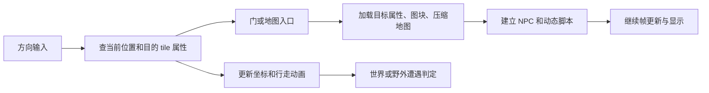
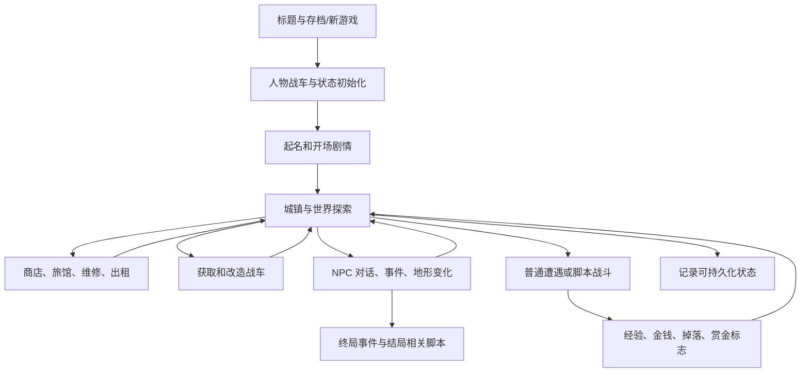

# Metal Max NES 全 ROM 反汇编、资源与游戏逻辑技术文档

分析日期：2026-10-21。输入是当前目录的 `mm.nes`，不是 FCEUX Android 工程 assets 中同名游戏的另一份文件。

这份目录提供全 ROM 的字节保留汇编、编辑器已知格式的结构化资源、所有 CHR 原始图块、277 条剧情脚本、实际
FCEUX 执行记录，以及代码和资源之间的关联索引。原文件没有覆盖。

**完整性分为两层：所有 786,448 个 ROM 字节都已导出并能重新组装为原文件；所有字节的游戏语义尚未全部恢复。
** 主汇编中无法确认的区域明确使用 `.byte`，另有推测反汇编视图。原作者符号、精确函数边界、全部战斗算法与所有终局路径不能仅凭字节覆盖率宣称已还原。

输入 SHA-256：`a6e3365cdeadcdbd3dcf3c15dd0d043e6c04f88cb7a12686bd3cad56495e730c`。汇编重组 SHA-256
相同，校验见 [verification.json](../analysis/verification.json)。

## 1. 交付物导航

| 目录或文件                                                                     | 内容                                              |
|---------------------------------------------------------------------------|-------------------------------------------------|
| [assembly/all_rom.asm](../assembly/all_rom.asm)                           | header、64 个 PRG bank、完整 CHR 数据，按物理 ROM 顺序保留全部字节 |
| [assembly/all_prg.asm](../assembly/all_prg.asm)                           | 完整 PRG 的代码/数据混合汇编                               |
| `assembly/prg_bank_XX.asm`                                                | 每个 8 KiB PRG bank 的独立汇编，包含文件地址、原字节和证据           |
| `assembly/speculative/`                                                   | 每个 bank 的线性推测解码；可用于继续分析，不作为确定代码                 |
| [assembly/overlapping_entries.asm](../assembly/overlapping_entries.asm)   | 实际执行的重叠入口，不能重复拼接到原 ROM                          |
| [assembly/semantic_symbols.inc](../assembly/semantic_symbols.inc)         | 已识别功能的分析标签和物理 bank                              |
| [resources/](../resources)                                                | 原始区块、地图、文字、人物、怪物、物品、战车、剧情、图像、声音等                |
| [analysis/instructions.json](../analysis/instructions.json)               | 26,047 条已接受指令，记录物理地址和 CPU 地址                    |
| [analysis/control-flow.json](../analysis/control-flow.json)               | 静态与运行期控制流，区分解算方式                                |
| [analysis/resource-references.json](../analysis/resource-references.json) | 指令到资源区引用，无法确定 bank 的引用保留未解析状态                   |
| [runtime/](../runtime)                                                    | 本机 FCEUX、输入序列、寄存器和内存访问、画面及音频                    |
| [all_story_scripts.md](all_story_scripts.md)                              | 全部剧情脚本和其引用的实际对话                                 |
| [event_flow.md](event_flow.md)                                            | 事件读、置位、清除与剧情关联                                  |
| [map-and-npc-index.md](map-and-npc-index.md)                              | 所有地图的底图、入口和 NPC 交互索引                            |
| [routine-index.md](routine-index.md)                                      | 静态入口和函数候选的指令列表                                  |
| [tools/](../tools)                                                        | 构建、导出、分析、文档和验证程序                                |

## 2. 方法和证据分级

资源侧复用 MetalMaxRe 核心库，私有编译副本把流改为串行，避免已知的并行 HashMap 写入问题。没有执行编辑器
Apply。除专用 JSON 外，还保留全部编辑器状态和命名地址，不能识别的字节有整段原始备份。

执行侧从用户提供的 FCEUX 内核建立 headless 驱动，不使用 Android JNI、画布或 Java 封装。驱动保留原
CPU/PPU/APU 和 Mapper 74 实现，插入指令前后、CPU 读写探针，记录物理 PRG 地址和映射。ROM 加载后再设置手柄接口，符合内核的
`GameInfo` 生命周期。

静态侧采用 151 个官方 NMOS 6502 opcode，使用向量、实测入口、bank
veneer、指针表和人工核对的分发表递归追踪。未执行的候选入口可能来自终止指令后的模式，因此标注证据并保留推测属性。CPU
的非法 opcode 语义仍在 FCEUX 源码中，主反汇编没有把任意数据强行转换成非法指令。

| 证据                      | 能支持的结论                          |
|-------------------------|---------------------------------|
| `executed`              | 指令起点及原字节在所记录场景中实际执行             |
| `recursive_static`      | 沿已知边和候选入口解码的合理代码路径，仍可能有边界误判     |
| `constant_bank_call`    | 根据附近常量和已确认 bank 函数解释出的跨 bank 调用 |
| `indexed_pointer_table` | 根据读指针指令推导的表和候选入口，表的语义还需核对       |
| `.byte`                 | 字节已完整保存，可能是资源、填充、指令参数或尚未发现的代码   |

当前接受 26,047 条指令、56,071 字节的代码分类，实际场景覆盖 12,169 个指令起点。该数字不是全游戏完成率。7
个重叠入口另行保留。

## 3. NES 硬件与 ROM 映射

```text
文件 00000..0000F   iNES header
文件 00010..8000F   PRG 512 KiB，64 × 8 KiB bank
文件 80010..C000F   CHR 256 KiB，256 × 1 KiB bank
Mapper             74，MMC3 PRG/IRQ + bank 8/9 映射 CHR RAM
```

FCEUX `boards/mmc3.cpp` 的 `FixMMC3PRG()` 决定 CPU $8000/$A000/$C000/$E000 四个窗口。游戏常态
`$8000 = R6`、`$A000 = R7`、`$C000 = bank 3E`、`$E000 = bank 3F`。`MMC3_cmd` bit6 可交换 R6 与固定倒数第二
bank，不能在所有上下文中无条件假设 C000 固定。

Mapper 74 把 CHR bank 8/9 选为 2 KiB 可写 CHR RAM。ROM 内的汉字图形需要 CPU 经 `$2007` 写入 CHR
RAM；因此“CHR 文件中的图像”和“游戏当帧实际字体”不是同一资源集合。

PRG bank 25..3D 的 25
份内容逐字节完全一致，原始重复仍全部保留。[identical-banks.json](../analysis/identical-banks.json)
记录每个 bank 哈希。bank 1E/3E 和 1F/3F 也有原始与汉化固定区的相似结构，但并非逐字节相同，不把它们合并。

### 地址表示

```text
PRG offset = bank × $2000 + CPU 窗口内偏移
文件 offset = $10 + PRG offset
CHR 文件 offset = $80010 + CHR 段内 offset
```

某个 `$A000` 地址在不同 bank 指向不同逻辑，不能用一个全局 A000 标签代表所有代码。主汇编注释中的
file/physical bank 才是稳定身份。`bank-contexts.json` 提供实际窗口记录。

## 4. 重置、汉化图块上传和标题流程

ROM 向量为：RESET `$FF3B`、NMI `$D144`、IRQ `$D176`。物理文件地址分别为 `7FF4B`、`7D154`、`7D186`。

RESET 开始禁用中断、清除十进制标志并关闭 PPU 显示，然后跳到 `$FF28`，写 `$8000 = 87`、`$8001 = 23`，将物理
bank 23 放到 A000 窗口，跳转 `$B7A0`。

```asm
FF3B  78        SEI 
FF3C  d8        CLD 
FF3D  a900      LDA #$00
FF3F  8d0120    STA $2001
FF42  4c28ff    JMP $FF28
FF45  ea        NOP 
FF46  ea        NOP 
FF47  8591      STA $91
```

bank 23 `$B7A0` 将 CHR RAM bank 8/9 挂接，读取 `$B800..$BFFF` 共 2048 字节，逐字节写到 PPU
`$0000..$07FF`，结束后回到固定区 `$FF47`
。该数据已另存 [boot_chr_ram_tiles.png](../resources/fonts/boot_chr_ram_tiles.png) 和原区块。

```asm
B7A0  a208      LDX #$08
B7A2  a982      LDA #$82
B7A4  8d0080    STA $8000
B7A7  8e0180    STX $8001
B7AA  a209      LDX #$09
B7AC  a983      LDA #$83
B7AE  8d0080    STA $8000
B7B1  8e0180    STX $8001
B7B4  ad0220    LDA $2002
B7B7  a000      LDY #$00
B7B9  a9b8      LDA #$B8
B7BB  850d      STA $0D
B7BD  a900      LDA #$00
B7BF  850c      STA $0C
B7C1  8d0620    STA $2006
B7C4  8d0620    STA $2006
B7C7  b10c      LDA ($0C),Y
B7C9  8d0720    STA $2007
B7CC  e60c      INC $0C
B7CE  d0f7      BNE $B7C7
B7D0  e60d      INC $0D
B7D2  a50d      LDA $0D
B7D4  c9c0      CMP #$C0
B7D6  d0ef      BNE $B7C7
B7D8  a904      LDA #$04
B7DA  8d0020    STA $2000
B7DD  4c47ff    JMP $FF47
```

后续初始化等待 PPU 垂直空白、设置堆栈，禁用 DMC IRQ/APU frame IRQ、MMC3 IRQ，初始化镜像与 WRAM
访问，清理工作内存，并设置 `$30/$31` 的 NMI 工作指针、PPU 控制镜像 `$11/$12`。最后调用音频初始化、配置初始
PRG banks 和 CHR banks。

标题和存档选择在 bank 14 的代码中完成。可以看到 `$67F0/$67F1` 的记录标记、存档校验入口和选择逻辑；玩家在标题按
A/Start 后进入旧记录或新游戏流程。实际轨迹验证到了起名、主角家开场、拉多、世界地图和一次普通战斗，没有仅凭菜单文字推断已通关。

## 5. 中断、帧同步与画面更新

### NMI

`$D144` 先跳到 `$CF40` 保存 A/X/Y。汉化额外路径根据 `$678F`，临时切到 PRG bank 0A 调用 `$9A96`，完成后恢复原
R6，回到 `$D149`。这把汉字图形准备与原游戏的 NMI 尾部连接起来。

`$34` 是 NMI 工作状态：负值跳过工作；零值使用公共尾部；其他值通过 `$30/$31` 指针跳到具体帧工作函数。
`$D155` 调用音频 tick、递增 `$36` 帧计数，再恢复寄存器 RTI。

```asm
CF40  48        PHA 
CF41  8a        TXA 
CF42  48        PHA 
CF43  98        TYA 
CF44  48        PHA 
CF45  ad8f67    LDA $678F
CF48  d016      BNE $CF60
CF4A  a520      LDA $20
CF4C  48        PHA 
CF4D  a20a      LDX #$0A
CF4F  20f9d3    JSR $D3F9
CF52  ad0220    LDA $2002
CF55  20969a    JSR $9A96
CF58  ea        NOP 
CF59  ea        NOP 
CF5A  ea        NOP 
CF5B  68        PLA 
CF5C  aa        TAX 
CF5D  20f9d3    JSR $D3F9
CF60  4c49d1    JMP $D149
CF63  a5b8      LDA $B8
CF65  c906      CMP #$06
CF67  d00b      BNE $CF74
CF69  a5b9      LDA $B9
```

### IRQ

`$D176` 保存寄存器，依据 `$35` 配置 MMC3 IRQ，利用 `$32/$33` 间接跳转到场景 handler；handler
的返回路径由手动压栈构造。`$D220` 从 `$D44B` 表读取当前 handler 指针。

```asm
D176  48        PHA 
D177  8a        TXA 
D178  48        PHA 
D179  98        TYA 
D17A  48        PHA 
D17B  a535      LDA $35
D17D  f00f      BEQ $D18E
D17F  8d00e0    STA $E000
D182  8d01e0    STA $E001
D185  a9d1      LDA #$D1
D187  48        PHA 
D188  a990      LDA #$90
D18A  48        PHA 
D18B  6c3200    JMP ($0032)
D18E  8d00e0    STA $E000
D191  68        PLA 
D192  a8        TAY 
D193  68        PLA 
D194  aa        TAX 
D195  68        PLA 
D196  40        RTI 
```

IRQ handler 切换 CHR、PPUCTRL 和滚动，支持标题、窗口或场景中的画面分段。静态分发表已保存，但每个条目的业务名称没有全部恢复。

### 帧等待和更新队列

`$D01D` 保存 X，在循环中等待 `$36` 的 NMI 帧计数变化，并调用每帧输入/辅助更新。游戏逻辑通过此函数等待真实帧推进，不是由
Android 包装控制各个 NPC 的动作。

```asm
D01D  8a        TXA 
D01E  48        PHA 
D01F  a636      LDX $36
D021  202ed0    JSR $D02E
D024  e436      CPX $36
D026  f0f9      BEQ $D021
D028  20f3d0    JSR $D0F3
D02B  68        PLA 
D02C  aa        TAX 
D02D  60        RTS 
```

`$D22F` 检查 DMA 标志 `$45`，从 `$0700` OAM shadow 执行 `$4014 = 07` DMA，再处理 PPU 队列和 CHR 更新。
`$0493` 一组缓冲可表达地址、长度、字节或地址/数据三元组。`$40..$47` 记录不同队列的数量和目标，`$43`
关联调色板刷新。这些地址由固定区的明确读写逻辑支持。

`$D386` 将 `$1A..$1F` 的 CHR shadow 刷到 MMC3 R0..R5；`$D3F9` 和 `$D414` 分别按 X 更新 PRG R6/R7，并缓存到
`$20/$21`。切换期间临时把 `$34` 设为 FF，避免 NMI 工作使用不完整的映射。

## 6. 主游戏状态与初始数据

新游戏初始化 bank 14 `$A010` 将初始人物数据复制到 `$6400`
附近，初始属性保存在 [players/data.json](../resources/players/data.json)
，初始战车保存在 [tanks/data.json](../resources/tanks/data.json)。

主角初始等级 1、HP 80、力量 10、智力 10、速度 20、体力 15；装备和背包 ID
原样保留，真实属性要通过物品和数值表解释。三个人物分别有独立状态、队伍标志、异常状态、经验和装备穿戴位。

```asm
A010  a947      LDA #$47
A012  850a      STA $0A
A014  a964      LDA #$64
A016  850b      STA $0B
A018  a9a7      LDA #$A7
A01A  8508      STA $08
A01C  a9a0      LDA #$A0
A01E  8509      STA $09
A020  a9b7      LDA #$B7
A022  850e      STA $0E
A024  a900      LDA #$00
A026  850f      STA $0F
A028  2071a0    JSR $A071
A02B  a900      LDA #$00
A02D  850a      STA $0A
A02F  a964      LDA #$64
A031  850b      STA $0B
A033  a947      LDA #$47
A035  850e      STA $0E
A037  a900      LDA #$00
A039  850f      STA $0F
A03B  a99f      LDA #$9F
A03D  8500      STA $00
A03F  2083a0    JSR $A083
A042  a9fe      LDA #$FE
A044  850a      STA $0A
A046  a964      LDA #$64
A048  850b      STA $0B
A04A  a919      LDA #$19
A04C  850e      STA $0E
A04E  a902      LDA #$02
A050  850f      STA $0F
A052  a900      LDA #$00
A054  8500      STA $00
```

起名入口 bank 10 `$B534` 建立字符表和姓名缓冲 `$051D...`。代码明确把名称录入、BACK、GO、END
等选择作为不同索引处理，姓名最终写入持久状态。选择表 ID `C3` 对应 END，`AF` 对应 GO，`9B` 对应
BACK。运行输入文件记录了按键和帧，可重现进入主角家中的流程。

工作 RAM 的部分用途：

| 地址             | 由当前证据支持的用途                                        |
|----------------|---------------------------------------------------|
| `$11/$12`      | PPUCTRL/PPUMASK 镜像                                |
| `$17/$18/$19`  | $17 当前输入，$18 新按下边沿，$19 按方向查表得到的输入/方向状态，参考 `$D0F3` |
| `$1A..$1F`     | CHR bank 镜像                                       |
| `$20/$21`      | PRG $8000/$A000 bank 缓存                           |
| `$30/$31`      | NMI 工作指针                                          |
| `$32/$33`      | IRQ 工作指针                                          |
| `$34`          | NMI 工作/临界状态                                       |
| `$35`          | 场景/IRQ 模式，不能仅据此命名所有游戏状态                           |
| `$36`          | NMI 帧计数                                           |
| `$61`          | 当前地图 ID                                           |
| `$62/$63`      | 地图位置/滚动相关基准，角色显示另有固定偏移                            |
| `$0441..$0460` | 256 bit 剧情事件集合                                    |
| `$0461..$0480` | 第二组标志集合，单独 helper 处理                              |
| `$0493`        | PPU 更新数据缓冲之一                                      |
| `$051D...`     | 输入姓名暂存                                            |
| `$6400...`     | 可保存的人物、战车、道具等状态                                   |
| `$7000...`     | 地图 tile 及运行期工作空间                                  |

## 7. 地图加载、移动和场景转移

普通地图为连续 7 bit 编码，零单元后跟 tile 与重复次数，非零单元表达一个 tile；重复计数零表达 256 个
tile。宽高由地图属性决定，解码到二维 tile。

世界地图不同：65536 个 tile 按 4×4 块分为 4096 个记录位置，使用一字节索引、2 bit辅助表、1
bit组选择定位四个块池。地图区间可存在 CHR 文件中，CPU 通过 PPU 读写路径访问，不是所有资源都能当作 PRG
CPU 表直接读取。

每张地图还有属性 flags、移动范围、图块组、组合表、调色板、音乐、出入口指针、事件图块指针以及部分遭遇领域。

固定区 `$DD7F` 根据 `$61` 区分世界或普通地图，对当前位置查 tile。`$DE88` 再从 `$5B` 指向的地形属性表查该
tile 的属性。移动系统据此识别墙、门、入口、井盖、传送、电梯和调查功能。

出入口记录的源 X/Y 和目标 Map/X/Y 已全部导出，边界类型为 LAST、FIXED
或四方向目标。场景转移既可由地图入口触发，也可由剧情脚本传送触发；不能只按入口图推断全部可达场景。

本次从实际资源提取 822 条显式转移边，见 [map-graph.json](../analysis/map-graph.json)。地图底图不叠加运行期
NPC 和事件变化，完整场景要结合精灵、事件与游戏当前标志。



## 8. NPC、动态脚本与对话

精灵组由 ROM 索引定位，每个 NPC 基础记录 6 字节：type、raw X、raw Y、talk1、talk2、action。X/Y
低六位是坐标，高位表达朝向锁定、平移动画、可推动和忽略地形。

`talk1` 区分四类交互：计算机功能、清单服务、直接文本、静态脚本。`talk2` 按模式分别解释为参数、文本段或脚本
ID。全部 639 条记录见 [npc-index.json](../resources/sprites/npc-index.json)。

### 动态解释器

bank 1A `$A7AE` 读取 NPC 动作状态，暂时选中 script bank，按脚本索引建立 `$AE/$AF` 指针并取当前执行位置。
`$A968` 把至多六个指令/参数字节复制到 `$B0...`，根据 opcode ×2 查询 `$A983` 的处理表，压入 target-1
并使用 RTS 跳转。

这是游戏的一种真实字节码执行机制。处理表的 116
个项已解析为 [dynamic-script-dispatch.json](../analysis/dynamic-script-dispatch.json)
，每个条目保留表位置、存储的地址减一和实际目标。

```asm
A968  a200      LDX #$00
A96A  b1ae      LDA ($AE),Y
A96C  95b0      STA $B0,X
A96E  c8        INY 
A96F  e8        INX 
A970  e006      CPX #$06
A972  90f6      BCC $A96A
A974  a5b0      LDA $B0
A976  0a        ASL A
A977  a8        TAY 
A978  b984a9    LDA $A984,Y
A97B  48        PHA 
A97C  b983a9    LDA $A983,Y
A97F  48        PHA 
```

handler 的返回结果还用于推进 NPC 的脚本偏移、设置等待、移动或事件状态。因此不能用 6502
线性反汇编解释剧情脚本原字节；脚本 opcode 与 6502 opcode 是两套独立指令。

### 静态脚本和对话

bank 1A `$A809` 的 NPC 交互路径根据对象交互字段，直接文本/服务走各自入口，静态脚本路径选中 bank 13，从
`$9377/$9378` 索引取得脚本指针，使用 `$0376` 保存当前偏移，并调用与动态脚本共同的 `$A968` RTS
分发器。静态路径循环执行直到 opcode 00，因此对话/等待 handler 的阻塞与帧同步由具体指令处理。

审计确认：游戏静态脚本有效编号为1..108，编辑器数组编号为0..107；原文件名沿用编辑器编号，
`source-index.json` 的 `game_id/editor_index` 给出对应。NPC `talk2=0`
是无静态脚本，不能关联到编辑器脚本000。动态脚本编号0..168与编辑器一致，并已建立所有NPC的action引用。

静态脚本由 NPC 交互触发，支持条件、文本引用、物品、队伍、战车、战斗与事件等。脚本导出包含原 bin、AST、带类型的
`.mms`、重新编译 bin。169 条动态和 108 条静态全部逐字节往返成功。

静态与动态对话短编码不同，例如静态页 05 的引用使用 `01 segment`，动态页 0E 使用 `68 segment`
。恢复可读脚本时必须保留 `#type`。

2669 段文本已按 page/row 导出，并保留控制 Action 与原始字节表达。文本混合单字节字符、双字节汉字、等待、选项和精灵动作，
`[9F]` 表示结束。文本到 glyph 的游戏显示还包含汉化字模加载，原始 glyph 数据和当前 CHR RAM 快照均保留。

## 9. 事件系统和完整剧情索引

事件 helper `$FEDF` 将输入事件编号拆为 `X = id >> 3`、`Y = id & 7`。`$FE85` OR 位掩码到 `$0441,X` 置位；
`$FE92` AND 反掩码清除；`$FE9F` 查询并恢复 X/Y 及标志。

```asm
FEDF  aa        TAX 
FEE0  2907      AND #$07
FEE2  a8        TAY 
FEE3  8a        TXA 
FEE4  4a        LSR A
FEE5  4a        LSR A
FEE6  4a        LSR A
FEE7  aa        TAX 
```

事件字节码 04/05 连接置位/清除 helper；06 等条件读取事件。地图事件图块、NPC 动作、宝藏、剧情资格和城镇状态共同依赖这些标志。

事件备注来自编辑器 `event_codes.txt`，并非原作者符号。当前记录覆盖例如：获得战车 08..0F；城镇标志
30..3B；赏金首状态
50..58；光环大楼、实验室、再生丸和各种剧情开关。全部关系在 [event_flow.md](event_flow.md)，没有删除未识别编号。

### 开场流程

FCEUX 画面已经验证：标题 → 新游戏 → 起名 → 主角家中的父亲对话 → 开场移动/离开限制 →
菜单与家中自由移动 → map 02 外部区域 → 拉多 map 01 → 世界地图 map 00 → 普通遭遇战 →
奖励后返回探索。姓名、队伍、初始装备和地图位置由 ROM 数据初始化，开场动态脚本通过 NPC 动作和事件逐步推进。

### 全地图剧情流程

十二个城镇依次为：拉多, 麦基, 波布, 奥多, 罗克, 弗里, 伊尔, 索鲁, 卡拉, 伊甸, 塔镇,
地狱门。文档没有把城镇名称顺序自动解释为必须线性通过的剧情；游戏具有探索、分支、战车收集和赏金首目标。

对于每一个静态/动态脚本，[all_story_scripts.md](all_story_scripts.md) 给出条件、事件读写、执行动作和实际对话；每个地图的
NPC 关联见 [map-and-npc-index.md](map-and-npc-index.md)。这组材料提供整 ROM 的剧情程序清单，而不是仅概述开场。

主流程的资源关系可以表示为：



Ending 节点表示脚本和事件中存在终局流程，当前没有实际运行到结局，不补造一套已经确认的通关步骤。

## 10. 战斗、遭遇与成长

怪物有原始属性与解释后的属性。电子类 HP 原始值 ×4；攻击/防御的高位扩展分别来自 hit/evasion
bit7；经验和金钱各有 ×100 标志。抗性字节包含冰、火、气体和自动恢复索引；ability
表达攻击次数、锁定攻击模式/目标、分裂、死亡爆炸和回避等级。

解释后的 131 个怪物数据见 [monsters/interpreted.json](../resources/monsters/interpreted.json)
。真实伤害计算还需追踪战斗函数的上下文，不能把 HP/攻击数值的解析规则当成完整伤害公式。

遭遇系统包括 256 项世界领域、93 个领域记录、56 个特殊怪物组、权重与数量表。世界 tile/领域和普通地图的
monsterRealmIndex 决定候选组，概率表控制抽取和数量。bank 10/17/19/1C
的代码引用对应数值及运行期人物状态，导出静态指令和数据引用可继续追踪。

战斗循环涉及建立参与者、异常和装备状态、玩家命令、目标、顺序、动作效果、死亡及奖励。`world-and-battle`
实验已经进入普通遭遇战，截图中出现两只蚁形怪物；当时 `$35 = 3`。随后的 A 键输入推进命令，HP 从 80 变为
67、60、53，经验从 0 增至 4，金钱从 50 增至 56；最后 `$35` 回到 0
并恢复世界地图探索。这是普通战斗、受伤和奖励流程的实际证据。赏金战与终局战没有全部执行，精确命中/伤害/RNG
公式仍未全部恢复。

升级需要累积经验表，玩家经验为 24 位。物品攻击、防御、价格和赏金引用共享数值表，不能把一个 byte
当作全部真实数值。数值表的“三字节用途”部分实际存 16 位并按特定项乘十，所有索引及原值都导出。

### 本次战斗的明确写回路径

bank 17 `$AF03` 根据人物状态对 `$C0/$C1` 伤害进行条件减半，再根据 `$70F1` 区分人物 HP 与战车 SP
的扣减；SP 路径为 `$AFE7`。这确认人物/乘车目标的资源扣减分流。

bank 17 `$B011` 用人物 ID `$D1` 左移作为索引，从 `$6466/6467` 减去 `$C0/C1` 的伤害，写回
HP；减法下溢或零时钳为零，并设置 `$647B` 异常/死亡状态。运行统计捕获了该写回四次。这确认 HP
扣减函数，不能代替其上游所有伤害公式。

bank 13 `$9981` 写回人物 24 位经验 `$64C9..64CB`；固定 bank 3F `$EDCB` 给 24 位金钱 `$645D..645F` 加上
`$DF..E1`，随后与 9999999 上限比较并钳制。经验和金钱变化与本次战斗结束相符。

```asm
B011  a5d1      LDA $D1
B013  0a        ASL A
B014  aa        TAX 
B015  38        SEC 
B016  bd6664    LDA $6466,X
B019  e5c0      SBC $C0
B01B  9d6664    STA $6466,X
B01E  bd6764    LDA $6467,X
B021  e5c1      SBC $C1
B023  9d6764    STA $6467,X
B026  9005      BCC $B02D
B028  1d6664    ORA $6466,X
B02B  d024      BNE $B051
B02D  a900      LDA #$00
B02F  9d6664    STA $6466,X
B032  9d6764    STA $6467,X
B035  8dea70    STA $70EA
B038  a4d1      LDY $D1
B03A  a9ff      LDA #$FF
B03C  85e5      STA $E5
B03E  997b64    STA $647B,Y
B041  cca305    CPY $05A3
B044  d003      BNE $B049
B046  8da305    STA $05A3
B049  cca271    CPY $71A2
B04C  d003      BNE $B051
B04E  8da271    STA $71A2
```

## 11. 战车、装备、经济与地图服务

初始 8 辆自有战车和出租战车的底盘、防御/上限、重量、SP、炮弹、装备、孔位及地图位置来自 tank 数据。`NO_1`
初始位置为 map 8B、(21,21)，底盘防御 60、重量原值 400、SP 30；本 ROM 的具体数据以 JSON 为准。

bank 1A `$B711` 遍历战车地图状态 `$0413` 与当前地图 `$61`，使相应图像对象在场景中生效。人物是否乘车、孔位、装备损坏、残弹、载重和
SP 分别影响运行期与战斗。

639 个 NPC 中的交互模式连接清单和服务。清单内容包括战车/人类装备、道具、出租坦克、旅馆、酒吧、售货机、弹药、装饰、点唱机、电梯等；并非所有
NPC 都通过剧情字节码直接出售物品。

全部 221 个物品条目、数值表、计算机、宝藏、随机调查、传送和电梯数据均有独立资源文件。物品价格索引 FE/FF
等保留特殊语义，解释 JSON 不把它们按普通价格换算。

## 12. 音频流程和资源

音频 bank 1D 有三个入口跳转：A000 初始化、A003 选曲、A006 每帧更新。固定区 D362 暂时将 R7 切到 1D 调用
A006，再恢复原 R6/R7。声音更新作为 NMI 公共尾部的一部分推进。

音频记录共 123 项，head 的四位控制噪声、三角波、方波 2、方波 1
是否存在，后续是各声道流指针。音频记录的游戏编号为1..123，对应编辑器数组0..122；0是停止/初始化命令。1..12通常从CPU8000窗口的bank0D取流，13..26使用0E，27..111使用0F。若指针本身位于A000..BFFF，则从固定音频驱动窗口bank1D取字节，112..123就在此范围；AA6F的FF表示不切R6，不能解释为使用bank0A。各声道记录同时保留game_id、editor_index、物理bank和源地址。A000
音频驱动区包含 APU 寄存器控制和命令解释。

```asm
D362  a287      LDX #$87
D364  a91d      LDA #$1D
D366  8e0080    STX $8000
D369  8d0180    STA $8001
D36C  58        CLI 
D36D  2006a0    JSR $A006
D370  a286      LDX #$86
D372  a520      LDA $20
D374  78        SEI 
D375  8e0080    STX $8000
D378  8d0180    STA $8001
D37B  e8        INX 
D37C  a521      LDA $21
D37E  8e0080    STX $8000
D381  8d0180    STA $8001
D384  58        CLI 
D385  60        RTS 
```

`resources/audio/index.json` 保存记录、对应物理 bank 和指针，`sequences/*.bin`
按下一个不同指针截取原始序列。该截取不是经过完整音符结束命令验证的独立 MIDI 曲目，因此同时保留全部原始
PRG，及 `sound_bank_0D.bin`。

124 个游戏命令 ID（0为停止，1..123为音频记录）的 WAV
预览位于 [audio/rendered](../resources/audio/rendered)，每项采样约十秒；片段现在按每帧实际sample
count切分，旧的平均帧长度切分已替换。片段是预览而非证明整条曲目完整播放，原始完整采集 PCM/WAV 另行保留。

runtime 中 PCM/WAV 来自真实 FCEUX APU 合成。专门的 audio-survey 用合成 JSR 调用游戏已确认的 D350 选曲
veneer，对全部音频 ID 采样；它是人工输入状态实验，不代表这些音乐都在自然游戏流程中播放过。音频状态机和
mapper 行为仍由原 ROM 执行。

## 13. 存档与持久化

当前可持久化主状态主要位于 $6400 附近，字段包括三个人物名称、八辆战车名称、钱、HP、属性、队伍、装备、经验、战车
SP/防御/重量、残弹、道具、赏金击破和其他标志。

ROM 的标题逻辑还操作 $67F0/$67F1 记录标记和校验数据，bank 14 BE47 计算指定存档范围的按字节反相加和。其步骤和
RAM 读写都有运行证据。MetalMaxRe `SaveHelper` 从外部 SAV offset 400 截取 36E 字节只是它支持的格式约定，不等价于
FCEUX 所有 save-state 文件。

Mapper 的 8 KiB battery WRAM 是持久化硬件基础；headless 分析禁用 battery 输出，避免改变旁边已有存档。各
runtime CPU/WRAM 快照可用于对比初始化和剧情后的状态。

## 14. 运行期覆盖与限制

| 场景                  |    帧数 |       执行指令数 | 不同指令起点 | 说明                  |
|---------------------|------:|------------:|-------:|---------------------|
| audio-survey        | 74100 | 658,217,490 |   2497 | 人工逐曲选曲实验            |
| audit-audio         | 74700 | 663,548,140 |   2497 | 启动/起名探索             |
| audit-font          |  5464 |  49,081,618 |   9646 | 启动/起名探索             |
| audit-title         |  1800 |  16,077,724 |   2058 | 启动/起名探索             |
| audit-world-battle  |  5464 |  49,081,618 |   9646 | 启动/起名探索             |
| explore-menu-battle | 19000 | 171,629,075 |   8325 | 开场家中探索与菜单           |
| leave-house         |  2200 |  19,957,483 |   4062 | 启动/起名探索             |
| name-back           |  5500 |  49,257,751 |   3752 | 启动/起名探索             |
| name-go             |  6500 |  58,253,959 |   3761 | 启动/起名探索             |
| name-go2            |  3000 |  26,888,235 |   3755 | 启动/起名探索             |
| name-nav            |  4000 |  35,841,926 |   3758 | 启动/起名探索             |
| newgame             |  2500 |  22,381,966 |   3715 | 启动/起名探索             |
| newgame-complete    |  6500 |  58,667,963 |   6357 | 起名结束及主角家开场          |
| opening-explore     | 13000 | 117,475,353 |   7731 | 开场剧情与探索             |
| opening-state       | 19000 | 171,629,075 |   8325 | 启动/起名探索             |
| outside-rado        |  6150 |  55,563,913 |   6267 | 启动/起名探索             |
| rado-exit-path      |   500 |   4,550,718 |   3948 | 主角家外部到拉多            |
| start-confirm       |  4000 |  35,844,741 |   3715 | 启动/起名探索             |
| title               |  1800 |  16,077,724 |   2058 | 启动/起名探索             |
| world-and-battle    |  5464 |  49,081,618 |   9646 | 世界地图普通遭遇、战斗及奖励后返回探索 |
| world-walk          |  7260 |  65,617,339 |   6304 | 启动/起名探索             |

场景名 `explore-menu-battle`
是输入实验计划名，截图实际仍在主角家，不能据此声称覆盖战斗。输入文件有每段结束帧和按键掩码，A=1、B=2、Select=4、Start=8、Up=16、Down=32、Left=64、Right=128。

```text
instruction-sample.csv      每次实验最前 200000 条指令的寄存器样本
execution-counts.csv        完整实验每个物理指令起点的命中数
edges.csv                   非顺序控制流、调用/返回、间接跳转
io-writes.csv               mapper、DMA 和手柄写入
ram-access-counts.csv       指令到 RAM/WRAM 的读写统计
frame-state.csv             每帧 CPU、bank、输入、部分零页状态
frame_*.png/ppm             每 300 帧及最后一帧的画面
cpu_*.bin / ram_*.bin       当时内存快照
ppu_chr/nametable/oam/...   加强采集实验的图像硬件状态
```

尚未全部恢复的部分包括：未访问 bank 的真实控制流、全部间接跳转、精确源函数划分、战斗和 RNG
的所有数值公式、全部音符命令的语义、全部剧情路径的动态执行。原始字节全部保留，语义缺口另见 unresolved
和候选证据文件。

## 15. 可重建性和检查

当前按代码/资源/未分类保留区的统计如下。资源包括编辑器地址区间、原始 CHR 视图和已确认重复扩展
bank，所以“资源”不等于所有业务含义已经命名。

| 字节类别        |     数量 |
|-------------|-------:|
| Header      |     16 |
| 代码及静态候选     |  56071 |
| 资源/重复区的字节表示 | 685521 |
| 仍未分类        |  44840 |

未分类区域也按原地址单独导出到 [resources/unclassified](../resources/unclassified)
，没有遗漏。后续分析可据此集中处理语义缺口。

`tools/verify_export.py` 实际解析主汇编的官方 opcode、寻址方式、相对分支和 `.byte`，生成
`assembly/reassembled.nes`。它不直接复制 bin，也不根据注释 raw 字节重建。

当前重建完全一致：16 字节 header + 64×8192 PRG + 262144 CHR。所有实际执行起点都在主指令索引或重叠入口索引中。277
条剧情脚本逐字节重新编译一致；地图 PNG/JSON 各239份。

资源导出是无修改读取。编辑器原有全量 Apply 会截断地图 ED/EF 的问题不参与重建；主汇编重建走的是原 ROM
字节与指令编码。完整主汇编中保留 `.byte` 是保证不丢数据的机制，不将它计为语义已分析。

## 16. 复现和继续分析

另有 [game-index.sqlite](../analysis/game-index.sqlite) 本地查询数据库，索引全部指令、文本、地图、NPC、剧情和事件。例如可以按
`(bank,cpu)` 找指令，按文本内容搜索剧情，再按脚本关系回到地图 NPC。数据库和 JSON 都是派生索引，原始 ROM
和汇编仍是字节依据。

```sql
SELECT bank, cpu, mnemonic, operand FROM instructions WHERE bank=63 AND cpu BETWEEN 60875 AND 60900;
SELECT page, row, text FROM texts WHERE text LIKE '%诺亚%';
SELECT source, target, kind FROM map_edges WHERE source=1;
```

从工作目录运行：

```bash
python3 metalmax-reverse/tools/export_resources.py
python3 metalmax-reverse/tools/build_fceux.py
python3 metalmax-reverse/tools/run_scenarios.py
python3 metalmax-reverse/tools/disassemble.py
python3 metalmax-reverse/tools/analyze_game.py
python3 metalmax-reverse/tools/verify_export.py
python3 metalmax-reverse/tools/write_documentation.py
```

现有额外场景的 input.csv 已留存，可直接用 headless 重跑；基本 `run_scenarios.py` 只运行标题和起名探测，完整场景运行见
`run_full_analysis.py`。Java 依赖按 core/build.gradle 版本获取，C++ 编译使用 clang++ 和 zlib。

代码阅读优先级：固定区 bank 3E/3F 的帧和 mapper 服务 → bank 14 初始化、标题、地图 → bank 1A
NPC和动态解释器 → bank 10/17/19/1C 战斗、命令与状态 → bank 1D APU 驱动 → 其他资源与候选区域。

后续要推进完整语义恢复，应在当前精确字节基线上补充可控存档/场景输入，记录 bank
上下文和事件状态；对静态公式用小输入实验验证。新增标签应写清分析依据，不能把候选函数或事件备注当成原始作者符号。

## 17. 导出审计与后续确认

本轮审计见 [导出审计与数据缺口](export_audit_and_gaps.md)
。修复了空值调查点丢失、派生类字段覆盖、静态脚本/音频编号错位、装备真实数值缺失、模型透明/偏移/调色板和字体来源误判。独立校验由ROM直接读取字段和图像，不依赖文件能否正常打开。

字体进一步恢复了1671个明确编码的12×12单色字模，源PRG
bank为20..23，每字18字节，三个4列带，每字节高/低半字节表示两行。174次完成的NMI图块上传与临时字模缓冲一致，字库字符名称仍来自编辑器映射表。此前25..3D“fontbank”图集改为原始重复字节视图。

汇编的证据现在细分executed、recursive_static和static_candidate，CPU地址从逐指令运行上下文或可见trace确认。187条原来未解析的静态边中68条有实测目标，119条仍未在运行中确定；实测目标不证明覆盖该边的全部bank状态。所有原字节仍可精确重建。
